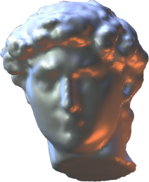
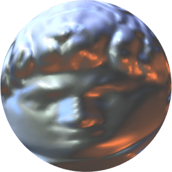

<h1 align="left"> Spherical Area-Preserving Parameterization</h1>

   &nbsp; &nbsp; &nbsp;
  

 

This repository provides an implementation of a convergent energy minimization method for spherical area-preserving parameterization of closed triangular meshes.

If you use this code in your own work, please cite the following paper:

> [1] **S.-Y. Liu** and **M.-H. Yueh**,  
> *Spherical Area-Preserving Parameterization via Energy Minimization*,  
> [doi: 10.1137/25M1736979](https://epubs.siam.org/doi/10.1137/25M1736979).

---
### Main Function
`[S] = SphericalAEM(F, V)`

Required Input:
* `F`: `#F x 3` triangulations of an closed triangle mesh
* `V`: `#V x 3` vertex coordinates of a closed triangle mesh

Output:
- `S`: `#V x 3` vertex coordinates of the spherical area-preserving map

Optional Input:
- `SphericalAEM( __, "MaxIter", Value)`: the maximum iterative number (default: 100)
- `SphericalAEM( __, "Tol", Value)`: the tolerance of objective function deficit (default: 1e-5)

---
### License
This software is released for academic and research purposes only.  
Commercial use is not permitted without prior written permission from the authors.

© 2026 Shu-Yung Liu and Mei-Heng Yueh

